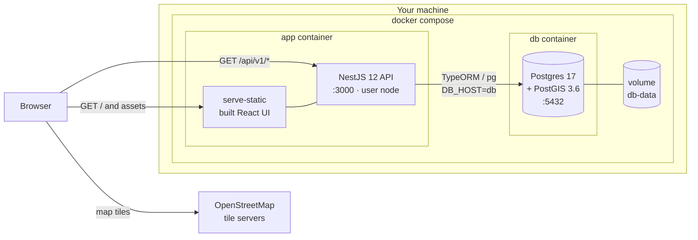
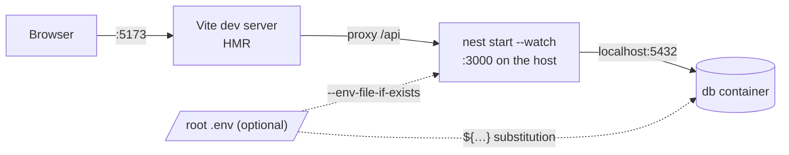
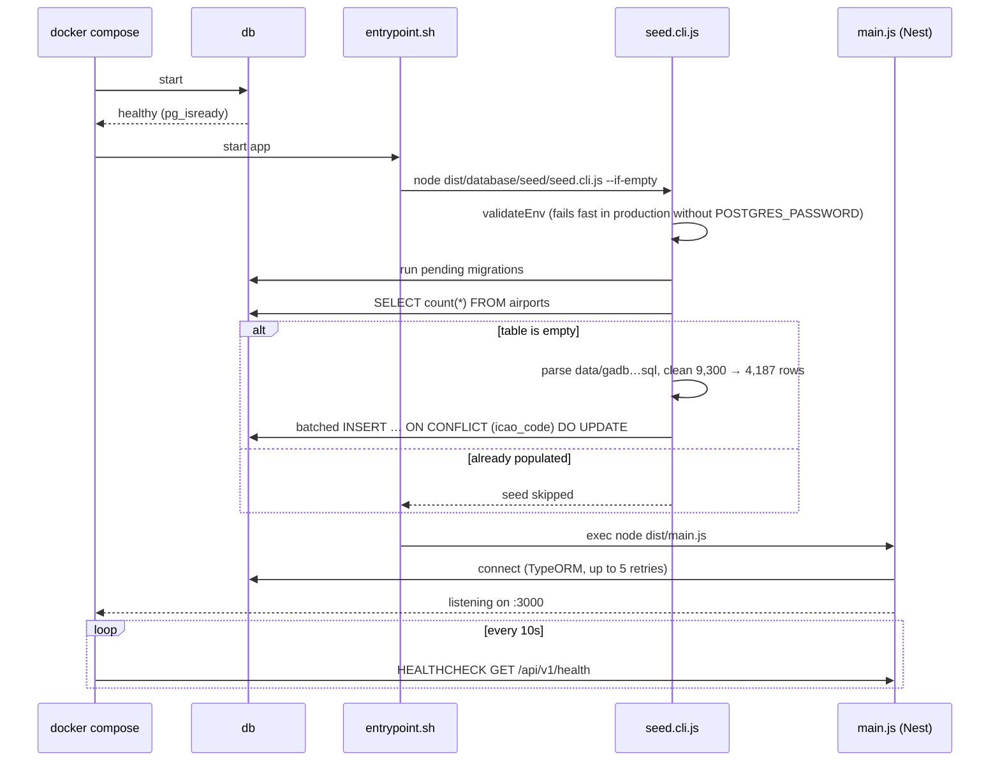
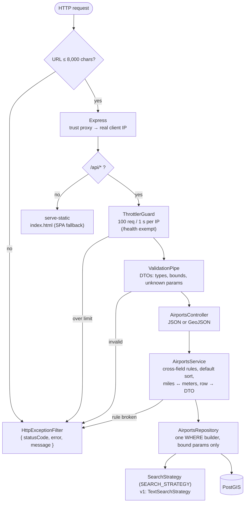
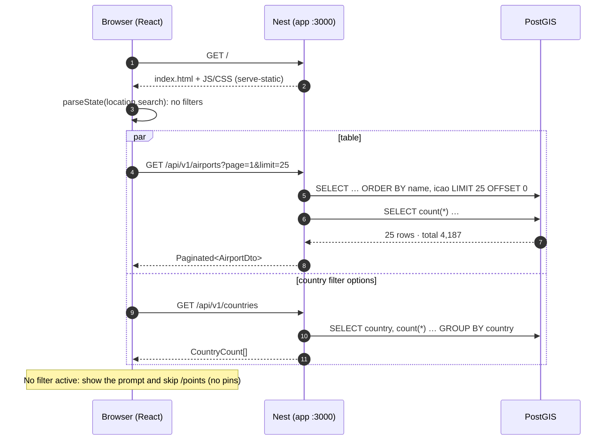
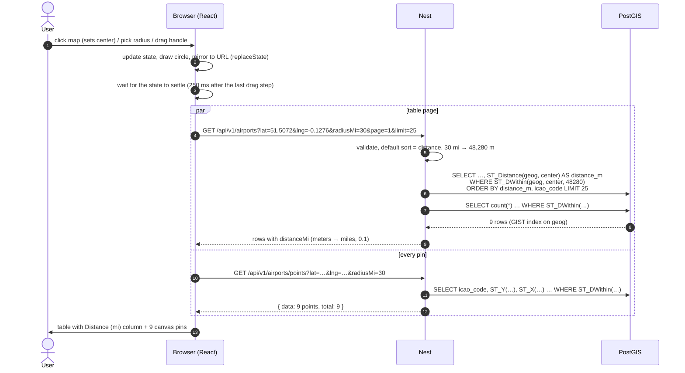
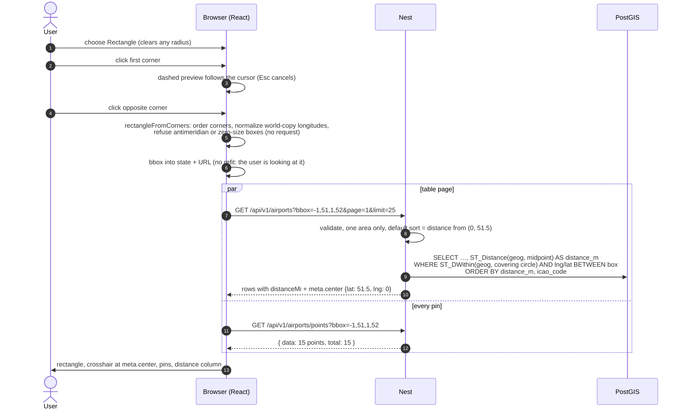
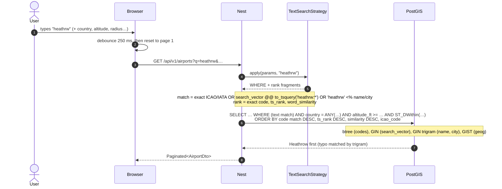
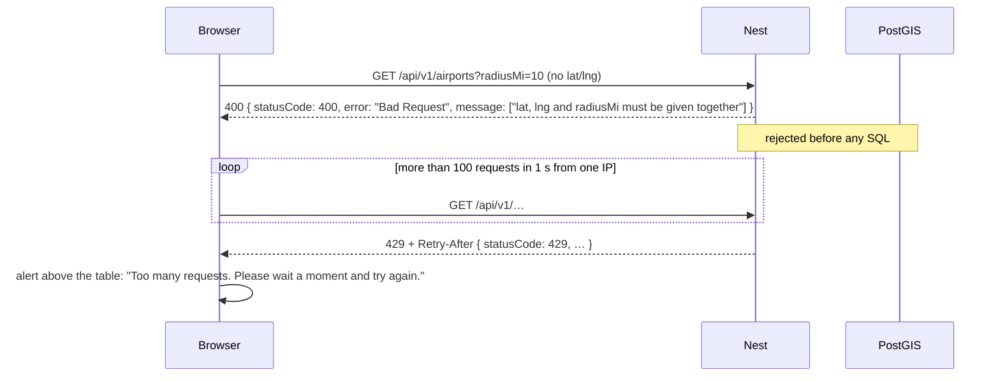
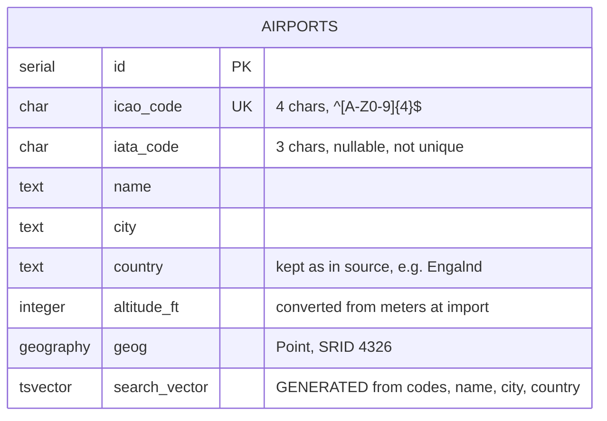

# Architecture

Two containers: one Node process serves both the React UI and the JSON API, and one Postgres +
PostGIS database holds 4,187 airports. The API is read-only. Units at the HTTP boundary are miles
and feet; PostGIS works in meters internally. Folder-by-folder details are in
[REPO_STRUCTURE.md](REPO_STRUCTURE.md); how changes are checked (git hooks and GitHub Actions) is
in [CI.md](CI.md).

## Deployment (Docker Compose)

|              | `app`                                                             | `db`                                                                                   |
| ------------ | ----------------------------------------------------------------- | -------------------------------------------------------------------------------------- |
| Image        | `docker/api/Dockerfile` (multi-stage, production deps only)       | `docker/db/Dockerfile` (`postgres:17` + PGDG PostGIS)                                  |
| Port         | `${APP_PORT:-3000}` → 3000                                        | `${DB_PORT:-5432}` → 5432                                                              |
| Health       | `GET /api/v1/health` via Node `fetch`                             | `pg_isready`                                                                           |
| Starts after | `db` is healthy                                                   |                                                                                        |
| Notes        | `init: true` (tini) so `docker stop` is immediate; runs as `node` | Data persists in `db-data`; the password applies only when the volume is first created |

Both read `POSTGRES_USER` / `POSTGRES_PASSWORD` / `POSTGRES_DB` from the same Compose
variables (root `.env`, falling back to the local default `airports`). `docker-compose.e2e.yml` is
the same pair with a tmpfs database on port 3100, for Playwright.

### Local development (no app container)

`pnpm docker:db` starts only the database; `pnpm dev` runs the API (with `NODE_ENV=development`)
and Vite side by side.

## Container startup

## Inside the API: one request's path

Every `/api/v1` request goes through the same layers. Validation and rate limiting reject bad
traffic before any SQL runs, and every error leaves through one filter with one shape.

## Call patterns: browser to database

### Page load

### Map click and radius (the main flow)

The UI keeps one query state. The circle and inputs update immediately; requests use the settled
state (250 ms debounce for typing and dragging), then fetch the table page and **every** pin in
parallel with the same filters.

### Rectangle (two clicks)

Rectangle mode draws on the client, then searches like the radius flow with `bbox` instead of
`lat`/`lng`/`radiusMi`. Distances are measured from the box's lng/lat midpoint, which the API
returns as `meta.center` for the map's crosshair.

### Text search combined with filters

### Errors and rate limiting

## Data model

| Index                                      | Type               | Serves                                                                                   |
| ------------------------------------------ | ------------------ | ---------------------------------------------------------------------------------------- |
| `airports_icao_code_key`                   | unique btree       | `/airports/:icao`, exact code match, upserts                                             |
| `airports_iata_code`                       | btree              | exact IATA match, `hasIata`                                                              |
| `airports_geog_gist`                       | GIST               | `ST_DWithin` radius, bbox prefilter, KNN `<->` for `/nearest`, `ST_Covers` for `/within` |
| `airports_search_vector_gin`               | GIN                | full-text prefix search                                                                  |
| `airports_name_trgm`, `airports_city_trgm` | GIN `gin_trgm_ops` | typo-tolerant `<%` matching                                                              |
| `airports_country`, `airports_altitude_ft` | btree              | country and altitude filters                                                             |

Index use is asserted by `apps/api/test/integration/airports.query-plans.int-spec.ts`.

## Where each concern lives

| Concern                                                                             | Enforced in                                                                                                                                      |
| ----------------------------------------------------------------------------------- | ------------------------------------------------------------------------------------------------------------------------------------------------ |
| Request shape and bounds                                                            | DTOs + global `ValidationPipe`                                                                                                                   |
| Cross-field rules (lat/lng/radius together, one area only, sort needs q or an area) | `search/search-criteria.ts`                                                                                                                      |
| SQL injection safety                                                                | `AirportsRepository` + `SqlParams` (bound parameters only); `tsquery.ts` sanitizes text                                                          |
| Rate limiting                                                                       | `ThrottlerGuard`, keyed on client IP across routes (`TRUST_PROXY` decides which hops to trust)                                                   |
| Request size (50 countries, 100-char `q`, 8,000-char URL)                           | DTO validation, `common/url-length.middleware.ts` (414) and the same checks in the web client; `common/request-size.spec.ts` pins the worst case |
| Error shape                                                                         | `HttpExceptionFilter`                                                                                                                            |
| Units                                                                               | `packages/shared/src/units.ts`, applied in the service                                                                                           |
| Production configuration safety                                                     | `config/env.validation.ts` (password required in production)                                                                                     |
| Data quality                                                                        | the seed pipeline (`database/seed/*`), pinned by tests to 4,187 rows                                                                             |
