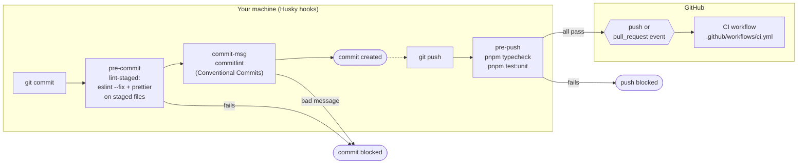
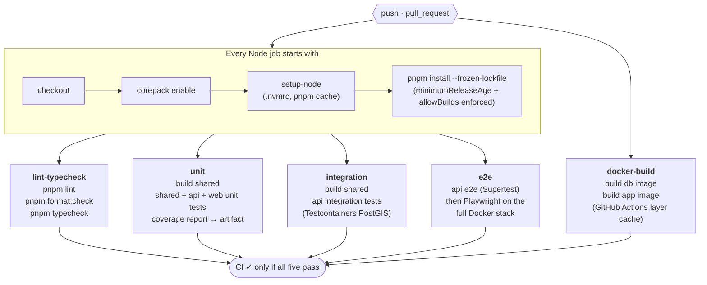
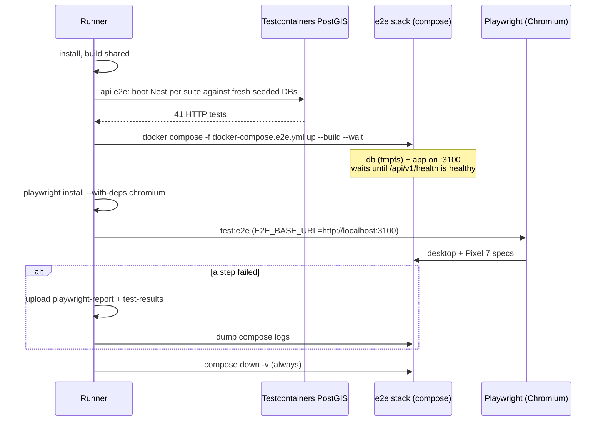

# Delivery pipeline: git hooks and GitHub Actions

How a change gets checked, from `git commit` on your machine to the CI run on GitHub. For the
running system (containers, requests, database) see [ARCHITECTURE.md](ARCHITECTURE.md).

**Nothing here deploys or publishes anything.** CI builds and tests; the Docker images are built
with `push: false` and thrown away. There is no deployment target yet.

## End to end

The hooks catch most problems in seconds, before anything leaves your machine. CI then repeats
those checks from a clean checkout (hooks can be skipped with `--no-verify`; CI cannot) and adds
the Docker-backed suites that are too slow for a hook.

## The CI workflow

All five jobs start **at the same time** on separate `ubuntu-latest` runners: none waits for
another (there are no `needs:` dependencies). The run is green only when all five pass.

### Inside the e2e job

The longest job. It tests the API over HTTP first, then starts the same containers you run
locally and drives a real browser against them.

## What runs automatically vs what needs you

### Starts by itself

| You do                                    | What runs                                                          | Where          |
| ----------------------------------------- | ------------------------------------------------------------------ | -------------- |
| `git commit`                              | `pre-commit` (lint-staged), then `commit-msg` (commitlint)         | your machine   |
| `git push`                                | `pre-push` (typecheck + unit tests, ~20–40 s), then the push       | your machine   |
| push reaches GitHub (any branch, any tag) | the full CI workflow: all 5 jobs                                   | GitHub Actions |
| open a PR, or push more commits to one    | the full CI workflow again, for the PR                             | GitHub Actions |
| push again before a run finishes          | the older run **for the same branch** is cancelled (`concurrency`) | GitHub Actions |

**Your first push** (`git push -u origin main`) triggers exactly one CI run: the `push` event on
`main`.

### Needs a manual action

| Action                                     | Why it isn't automatic                                                                                                                                      | How                                                                                                                   |
| ------------------------------------------ | ----------------------------------------------------------------------------------------------------------------------------------------------------------- | --------------------------------------------------------------------------------------------------------------------- |
| Re-run a failed or flaky job               | Failures are surfaced, never retried by the workflow (Playwright does retry a failing test twice inside the run)                                            | Actions → the run → **Re-run failed jobs**                                                                            |
| Start CI without pushing                   | There is no `workflow_dispatch` trigger                                                                                                                     | Push a commit, or re-run an existing run. Adding `workflow_dispatch:` under `on:` would add a **Run workflow** button |
| See coverage                               | Uploaded as an artifact, not reported inline                                                                                                                | Actions → the run → Artifacts → `unit-coverage`                                                                       |
| Debug a Playwright failure                 | Report and traces are uploaded only when the e2e job fails                                                                                                  | Artifacts → `playwright-report` (open `index.html`; traces load in trace.playwright.dev)                              |
| Block merging until CI passes              | GitHub doesn't require checks by default                                                                                                                    | Settings → Branches → add a rule for `main` and require the five checks                                               |
| Approve CI for an outside contributor's PR | On public repos GitHub can hold workflow runs from fork PRs until approved (by default, for contributors new to GitHub; configurable in Settings → Actions) | Approve the run on the PR                                                                                             |
| Deploy, or publish images                  | No deploy job exists and images are built with `push: false`                                                                                                | Not set up yet; this would be a new job (and secrets)                                                                 |

### Worth knowing

- **PR branches run CI twice.** `push` and `pull_request` both fire for a branch in this repo
  that has an open PR, and they use different refs, so `concurrency` doesn't merge them. Harmless,
  but twice the minutes. Limiting `push` to `branches: [main]` would leave one run per PR.
- **Tag pushes run CI too**, because `push` has no branch or tag filter.
- **Permissions are read-only** (`contents: read`) and the workflow uses no secrets, so a PR can't
  push code or read credentials through it.
- **`HUSKY=0` in CI** stops the git hooks from running on the runners, since CI runs the same checks
  as explicit steps.
