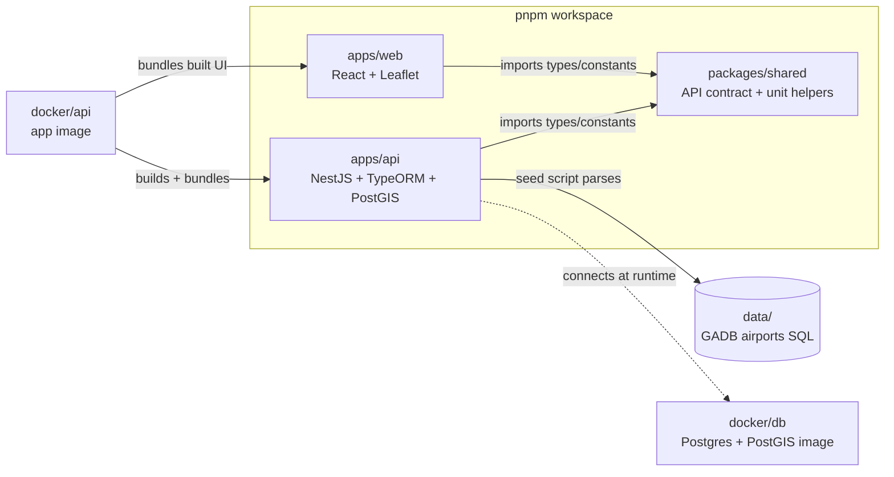
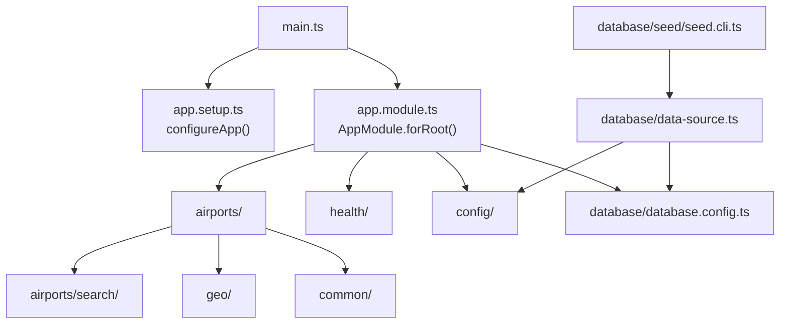
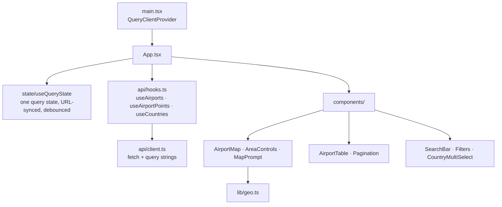

# Repository structure

A pnpm workspace with two apps and one shared package, plus the database image, Docker/CI
plumbing and the source dataset. See [ARCHITECTURE.md](ARCHITECTURE.md) for how the pieces run
and talk to each other.

## How the packages depend on each other

`packages/shared` is the only thing both apps import. A change to the HTTP contract there fails
typecheck on whichever side falls out of step.

## Top level

| Path                                                     | Purpose                                                                                                                                                                                                                                                                     |
| -------------------------------------------------------- | --------------------------------------------------------------------------------------------------------------------------------------------------------------------------------------------------------------------------------------------------------------------------- |
| `apps/`                                                  | The two applications: `api` (backend) and `web` (frontend).                                                                                                                                                                                                                 |
| `packages/shared/`                                       | Code shared by both apps (see below).                                                                                                                                                                                                                                       |
| `data/`                                                  | `gadb_postgresql_create_airports_table.sql`, the Global Airport Database (MIT, Arash Partow). Treated as data: the seed script parses it and never executes it.                                                                                                             |
| `docker/`                                                | Dockerfiles: `db/` (Postgres + PostGIS) and `api/` (the app image).                                                                                                                                                                                                         |
| `docs/`                                                  | This file, [ARCHITECTURE.md](ARCHITECTURE.md) (runtime) and [CI.md](CI.md) (hooks + GitHub Actions).                                                                                                                                                                        |
| `docs/rulesets/protect-main.json`                        | Reference copy of the `main` branch protection ruleset (PR required, five checks required, no force push/deletion, no bypass). Not enforced from here: GitHub enforces the copy in repo settings; this file is applied with `gh api`. See [CI.md](CI.md#branch-protection). |
| `.github/workflows/ci.yml`                               | CI: lint/format/typecheck, unit, integration, e2e (API + Playwright) and image builds, all in parallel on pushes to `main` and on pull requests. See [CI.md](CI.md).                                                                                                        |
| `.husky/`                                                | Git hooks: `pre-commit` (lint-staged), `commit-msg` (commitlint), `pre-push` (typecheck + unit tests).                                                                                                                                                                      |
| `docker-compose.yml`                                     | Local stack: `db` + `app` on <http://localhost:3000>, with a persistent `db-data` volume.                                                                                                                                                                                   |
| `docker-compose.e2e.yml`                                 | Throwaway stack for Playwright on port 3100 (tmpfs database, generous rate limit).                                                                                                                                                                                          |
| `package.json`                                           | Workspace scripts (`dev`, `typecheck`, `lint`, `test:*`, `docker:*`) and the pinned `packageManager` (pnpm 12).                                                                                                                                                             |
| `pnpm-workspace.yaml`                                    | Workspace members plus supply-chain settings: `minimumReleaseAge: 4320` (3 days) and `allowBuilds` (every dependency install script is denied unless listed).                                                                                                               |
| `.env.example`                                           | Template for the one root `.env`, read by Compose and by the api's host scripts.                                                                                                                                                                                            |
| `tsconfig.base.json`                                     | Strict compiler options shared by every package (TypeScript 6.0.x, ES2024).                                                                                                                                                                                                 |
| `eslint.config.mjs`, `.prettierrc.json`, `.editorconfig` | Lint/format rules for the whole repo.                                                                                                                                                                                                                                       |
| `commitlint.config.mjs`                                  | Conventional Commits with the allowed scopes.                                                                                                                                                                                                                               |
| `.dockerignore`, `.gitignore`, `.nvmrc` (Node 24)        | Housekeeping.                                                                                                                                                                                                                                                               |
| `CLAUDE.md`                                              | Agreed decisions and toolchain constraints, for anyone (human or agent) changing the code.                                                                                                                                                                                  |

## `packages/shared`: the API contract

| File              | Purpose                                                                                                                                                                                                                            |
| ----------------- | ---------------------------------------------------------------------------------------------------------------------------------------------------------------------------------------------------------------------------------- |
| `src/airports.ts` | Request/response types for `/api/v1` (`AirportDto`, `Paginated`, `PointsResponse`, filters, `ErrorResponse`, GeoJSON shapes) and limits (`RADIUS_PRESETS_MI`, `MAX_RADIUS_MI`, `MAX_PAGE_LIMIT`, …).                               |
| `src/polygon.ts`  | Polygon rules shared by UI and API: parse/format `lng,lat;…`, `polygonProblems` (3–100 points, Mercator latitude range, no antimeridian crossing, no crossing/touching edges, non-zero area) and `polygonCentroid` (Web Mercator). |
| `src/units.ts`    | Mile/meter and meter/foot conversions (the API speaks miles and feet; PostGIS works in meters).                                                                                                                                    |

Built to `dist/` (ESM) by `pnpm build:shared`; both apps consume the built output.

## `apps/api`: NestJS 12 API (ESM)

### `src/`

| Path                                                 | Purpose                                                                                                                                                                                                                                   |
| ---------------------------------------------------- | ----------------------------------------------------------------------------------------------------------------------------------------------------------------------------------------------------------------------------------------- |
| `main.ts`                                            | Process entry: builds the app, applies `configureApp`, enables shutdown hooks, listens on `PORT`.                                                                                                                                         |
| `app.module.ts`                                      | Root module: config + env validation, pino logging, TypeORM connection, throttler (one budget per client IP across all routes), serve-static for the built UI when `WEB_DIST_PATH` is set.                                                |
| `app.setup.ts`                                       | `configureApp()`: the HTTP surface that isn't a module: `/api/v1` prefix, validation pipe, error filter, `trust proxy`, dev-only CORS, Swagger at `/api/docs`. Shared by `main.ts` and the e2e tests, so tests run the production wiring. |
| `config/env.validation.ts`                           | Joi schema for every env var the app reads, with defaults. **In production `POSTGRES_PASSWORD` is required** (or `DATABASE_URL`).                                                                                                         |
| `airports/airports.controller.ts`                    | `GET /airports`, `/airports/points`, `/airports/distance`, `/airports/:icao`, `/airports/:icao/nearest`; chooses JSON or GeoJSON (`format=geojson` or `Accept: application/geo+json`).                                                    |
| `airports/countries.controller.ts`                   | `GET /countries`.                                                                                                                                                                                                                         |
| `airports/airports.service.ts`                       | Turns validated input into criteria, calls the repository, maps rows to DTOs (meters → miles, rounding).                                                                                                                                  |
| `airports/airports.repository.ts`                    | **All airport SQL.** Builds the shared `WHERE` for every filter (text, country, IATA, altitude, `ST_DWithin` radius, bbox) with bound parameters only; KNN (`<->`), distance, polygon `ST_Covers`, countries.                             |
| `airports/search/search-strategy.ts`                 | The `SearchStrategy` seam (`SEARCH_STRATEGY` token): how free text becomes a `WHERE` fragment plus rank expressions.                                                                                                                      |
| `airports/search/text-search.strategy.ts`            | v1 strategy: exact ICAO/IATA match, then full-text prefix match on `search_vector`, then trigram typo matching; ranked in that order.                                                                                                     |
| `airports/search/tsquery.ts`                         | Sanitizes user text into a safe `word:* & …` tsquery (raw input never reaches `to_tsquery`).                                                                                                                                              |
| `airports/search/search-criteria.ts`                 | Cross-field rules (lat/lng/radius together, one area only: radius or bbox, min ≤ max, sort needs q or an area), default sort/order, and `referencePoint()`: the radius center or bbox midpoint distances are measured from.               |
| `airports/dto/`                                      | class-validator DTOs for query strings, path params and Swagger response docs.                                                                                                                                                            |
| `airports/airport.entity.ts`                         | TypeORM entity for the `airports` table.                                                                                                                                                                                                  |
| `geo/`                                               | Pure geo helpers: bbox parsing, haversine, bbox covering circle, GeoJSON serializers.                                                                                                                                                     |
| `common/http-exception.filter.ts`                    | Makes every non-2xx response `{ statusCode, error, message }` and never leaks internal error text.                                                                                                                                        |
| `common/validation.ts`                               | The global `ValidationPipe` (whitelist, reject unknown params, transform).                                                                                                                                                                |
| `common/sql-params.ts`                               | Positional-parameter collector used to build SQL safely.                                                                                                                                                                                  |
| `common/url-length.middleware.ts`                    | Refuses URLs over `MAX_REQUEST_URL_LENGTH` (8,000) with a 414 in the standard error shape, before any other work.                                                                                                                         |
| `common/request-size.spec.ts`                        | Builds the worst-case request URL from the real dataset (50 longest countries, maximum `q`, every parameter) and pins it below half the cap.                                                                                              |
| `health/health.controller.ts`                        | `GET /api/v1/health`: DB reachability + PostGIS version; 503 when down; exempt from rate limiting.                                                                                                                                        |
| `database/database.config.ts`                        | Entity + migration lists and `dataSourceOptions()` (no fallback password; callers pass validated env via `dbEnvFrom`).                                                                                                                    |
| `database/data-source.ts`                            | Standalone DataSource for the TypeORM CLI and the seed CLI, built from validated env.                                                                                                                                                     |
| `database/migrations/1760400000000-init-airports.ts` | The schema: `airports` table, generated `tsvector`, GIST/GIN/trigram/btree indexes, code format checks, `postgis` + `pg_trgm` extensions.                                                                                                 |
| `database/seed/gadb-parser.ts`                       | Tokenizes the GADB `INSERT` statements (handles `''` escapes) into typed rows.                                                                                                                                                            |
| `database/seed/cleaner.ts`                           | Drops unusable rows (`N/A` names, 0/0 coordinates, known-bad `PCIS`), maps `N/A` IATA to null, title-cases, converts altitude meters → feet. 9,300 rows in → 4,187 out.                                                                   |
| `database/seed/title-case.ts`                        | Dataset-tuned title casing (acronyms like `AFB`, `N'Djamena`, `McAllen`, `Charles de Gaulle`).                                                                                                                                            |
| `database/seed/seeder.ts`                            | Batched, idempotent upsert keyed on ICAO; `seedAirports({ ifEmpty })`.                                                                                                                                                                    |
| `database/seed/seed.cli.ts`                          | `node dist/database/seed/seed.cli.js [--if-empty]`: run migrations, then seed. The container runs this before the app.                                                                                                                    |

Unit tests sit next to the code as `*.spec.ts`.

### `test/`

| Path                                  | Purpose                                                                                                          |
| ------------------------------------- | ---------------------------------------------------------------------------------------------------------------- |
| `helpers/postgis.global-setup.ts`     | Builds `docker/db` and starts one PostGIS container per test run (Testcontainers).                               |
| `helpers/data-source.ts`              | `connectTestDataSource()` gives each suite its **own fresh database** on that container, so order never matters. |
| `helpers/seeded.ts`, `helpers/app.ts` | A migrated + seeded suite database, and the real Nest app booted against it for e2e.                             |
| `integration/`                        | Repository, migration, seed and query-plan (`EXPLAIN` index use) tests against real PostGIS.                     |
| `e2e/`                                | HTTP tests via Supertest: airports API, platform (health, Swagger, SPA fallback), rate limiting.                 |
| `scripts/env-file-scripts.spec.ts`    | Guards that `dev`, `seed` and `migration:run` load the repo-root `.env`.                                         |

| Config                                                 | Runs                                                                 |
| ------------------------------------------------------ | -------------------------------------------------------------------- |
| `vitest.config.ts`                                     | Unit tests (no Docker)                                               |
| `vitest.integration.config.ts`, `vitest.e2e.config.ts` | Docker-backed suites; shuffled order and parallel files on every run |
| `nest-cli.json`, `tsconfig*.json`                      | Build: `tsconfig.build.json` compiles `src/` to `dist/`              |

## `apps/web`: React 19 UI

| Path                                                                                     | Purpose                                                                                                                                                                                                                                                                                                                                                                                                                                                                                                                             |
| ---------------------------------------------------------------------------------------- | ----------------------------------------------------------------------------------------------------------------------------------------------------------------------------------------------------------------------------------------------------------------------------------------------------------------------------------------------------------------------------------------------------------------------------------------------------------------------------------------------------------------------------------- |
| `src/main.tsx`                                                                           | Mounts the app inside TanStack Query's provider; imports Leaflet CSS.                                                                                                                                                                                                                                                                                                                                                                                                                                                               |
| `src/App.tsx`                                                                            | Composes everything: one query state drives `/airports` (table page) and `/airports/points` (every pin). Decides when the map refits.                                                                                                                                                                                                                                                                                                                                                                                               |
| `src/state/queryState.ts`                                                                | The query-state shape, URL `serializeState`/`parseState`, "is any filter active", default sort.                                                                                                                                                                                                                                                                                                                                                                                                                                     |
| `src/state/useQueryState.ts`                                                             | Immediate `state` for inputs and the circle, and a settled `queryState` for requests. The whole state settles together, so the page reset can't escape the text debounce.                                                                                                                                                                                                                                                                                                                                                           |
| `src/state/useDebouncedValue.ts`                                                         | Debounce with an "apply immediately" escape for non-typing changes.                                                                                                                                                                                                                                                                                                                                                                                                                                                                 |
| `src/api/client.ts`                                                                      | Fetch wrapper: builds query strings (repeated `country`), refuses to send URLs over 8,000 characters, throws typed `ApiError`s.                                                                                                                                                                                                                                                                                                                                                                                                     |
| `src/api/hooks.ts`, `src/api/queryClient.ts`, `src/api/errors.ts`                        | Query hooks (keep previous data while fetching), no retry on 4xx, friendly error text (429, 414).                                                                                                                                                                                                                                                                                                                                                                                                                                   |
| `src/components/AirportMap.tsx`                                                          | react-leaflet map. Radius mode: click sets the center, circle + draggable edge handle. Rectangle mode: two clicks with a dashed preview. Polygon mode: clicks add points; double-click, a click within 10 px of the first point, or Enter closes; Escape cancels. Antimeridian/zero-size/self-intersecting shapes refused. Crosshair at the API's `meta.center`. Canvas pins (non-interactive). Frames a restored area once it has a size. Exposes `data-pin-count`/`data-center`/`data-bbox`/`data-polygon`/`data-mode` for tests. |
| `src/components/AreaControls.tsx`                                                        | Map toolbar: _Radius \| Rectangle \| Polygon_ switch (switching clears the area), radius presets plus "Custom (N mi)", polygon point count with Finish / Undo last point / Cancel (always shown, so the toolbar never changes height while drawing), and "Clear area".                                                                                                                                                                                                                                                              |
| `src/components/AirportTable.tsx`, `Pagination.tsx`                                      | Server-sorted, paginated results; distance column whenever there is an area.                                                                                                                                                                                                                                                                                                                                                                                                                                                        |
| `src/components/SearchBar.tsx`, `Filters.tsx`, `CountryMultiSelect.tsx`, `MapPrompt.tsx` | Text search, altitude/IATA filters, country picker (stops at 50), the mode-specific "click the map or search" overlay.                                                                                                                                                                                                                                                                                                                                                                                                              |
| `src/lib/geo.ts`                                                                         | Haversine miles, handle placement, radius from handle (rounded + clamped), bounds, and `rectangleFromCorners()` (corner order, world-copy longitudes, antimeridian and zero-size checks).                                                                                                                                                                                                                                                                                                                                           |
| `src/lib/polygonDraft.ts`                                                                | Polygon drawing logic: `addVertex` (rounding, world-copy continuity, antimeridian and 100-point checks, double-click de-duplication) and `finishDraft` (shared rules, friendly messages).                                                                                                                                                                                                                                                                                                                                           |
| `src/lib/format.ts`                                                                      | Number and mile formatting.                                                                                                                                                                                                                                                                                                                                                                                                                                                                                                         |
| `src/test/`                                                                              | MSW server and fixtures, a `react-leaflet` mock exposing click/drag callbacks, test setup.                                                                                                                                                                                                                                                                                                                                                                                                                                          |
| `e2e/`                                                                                   | Playwright specs (desktop + Pixel 7) against the full stack; `helpers.ts` compares pins and totals with the API.                                                                                                                                                                                                                                                                                                                                                                                                                    |
| `vite.config.ts`                                                                         | Vite + Tailwind; dev server proxies `/api` to `localhost:3000`.                                                                                                                                                                                                                                                                                                                                                                                                                                                                     |
| `vitest.config.ts`, `playwright.config.ts`                                               | Component tests (jsdom) and browser tests (`E2E_BASE_URL`, default `:3100`).                                                                                                                                                                                                                                                                                                                                                                                                                                                        |

## `docker/`

| Path                     | Purpose                                                                                                                                                                                                                 |
| ------------------------ | ----------------------------------------------------------------------------------------------------------------------------------------------------------------------------------------------------------------------- |
| `db/Dockerfile`          | `postgres:17` + PGDG PostGIS 3.6 packages: multi-arch, so it runs natively on Apple Silicon. Used by Compose **and** by Testcontainers.                                                                                 |
| `db/init-extensions.sql` | Creates `postgis` and `pg_trgm` on first init (the migration also ensures them).                                                                                                                                        |
| `api/Dockerfile`         | Multi-stage: `pnpm fetch` (cached on the lockfile) → offline install + build → `pnpm deploy --prod` → slim runtime as the `node` user with a Node-based `HEALTHCHECK`. Keeps the repo-relative layout the seeder needs. |
| `api/entrypoint.sh`      | `seed.cli.js --if-empty`, then `exec node dist/main.js`.                                                                                                                                                                |
